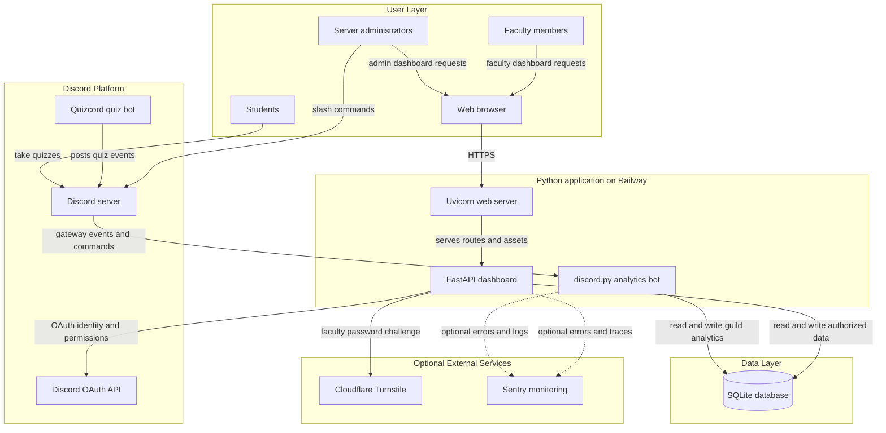
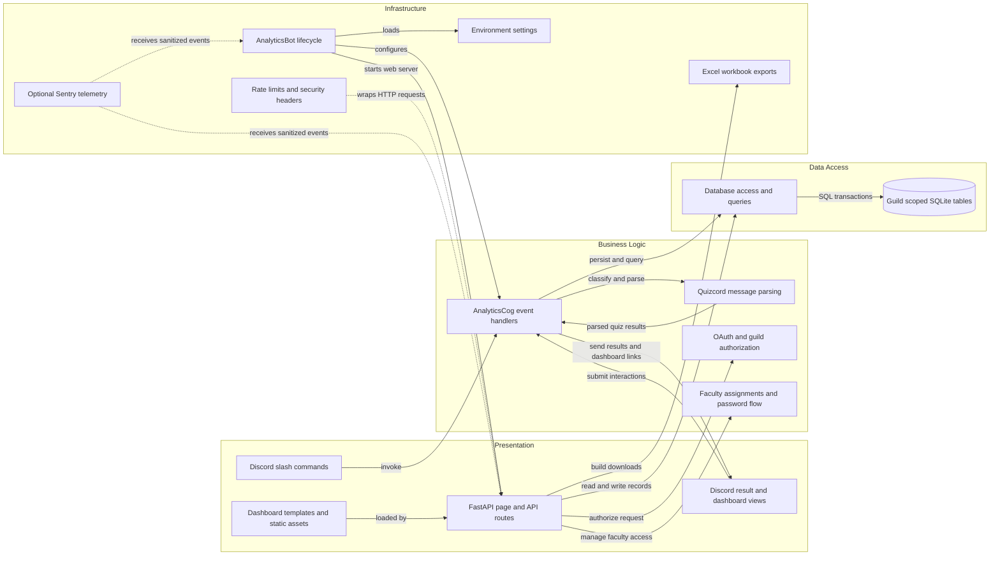

# Architecture Diagram

Quizcord Analytics is a Python Discord bot and authenticated web dashboard
deployed as one service. The bot and dashboard share a guild-scoped SQLite
database for quiz sessions, student mappings, and attendance analytics.

## Application Architecture

<!-- mermaid-checked: no \n, no em-dash/en-dash, no {} in labels, subgraphs are id["label"], arrows are -->|"label"|, all subgraphs closed by end, ids unique -->

### Technology Stack Summary

| Layer | Technology | Version | Purpose |
| --- | --- | --- | --- |
| Discord integration | Python and discord.py | Python 3.10 or newer; discord.py 2.3 to under 3.0 | Gateway events, slash commands, and Discord interactions |
| Web application | FastAPI and Starlette | FastAPI 0.115 to under 0.120; Starlette 0.40 or newer | Dashboard pages, API routes, sessions, and request middleware |
| Web server | Uvicorn | 0.30 or newer | Serves the dashboard in the bot process |
| Data persistence | SQLite via Python sqlite3 | Runtime-provided | Stores guild settings, student mappings, quiz sessions, and analytics |
| External API client | HTTPX | 0.27 or newer | Discord OAuth and API calls, and Turnstile verification |
| Deployment | Railway | Configured single replica | Runs the bot and dashboard with persistent database storage |
| Monitoring | sentry-sdk | 2.44 or newer, optional | Error reporting and sampled dashboard performance telemetry |

### Data Storage & External Services

SQLite is the sole application database. Its records are partitioned by guild,
and it is shared by the Discord bot and FastAPI dashboard in the same process.
Discord supplies the gateway, slash commands, OAuth identity, and server
membership data. Cloudflare Turnstile optionally protects faculty password
verification, while Sentry is optional for sanitized errors and performance
telemetry. The application has no message broker or distributed cache.

### Key Architectural Decisions

- The Discord gateway client and Uvicorn dashboard run in one Python service
  and share a single `Database` instance.
- Guild identifiers scope student mappings, quiz analytics, and faculty
  assignments; dashboard routes authorize access by administrator permission
  or configured faculty role.
- SQLite and OAuth session state are designed for one running replica; the
  database file must reside on persistent storage in hosted deployments.

## Component Relationships

<!-- mermaid-checked: no \n, no em-dash/en-dash, no {} in labels, subgraphs are id["label"], arrows are -->|"label"|, all subgraphs closed by end, ids unique -->

### Component Inventory

| Component | Layer | Type | Responsibility |
| --- | --- | --- | --- |
| Discord slash commands | Presentation | Discord application commands | Expose student mapping, manual import, export, and faculty-role configuration |
| Discord result and dashboard views | Presentation | Discord UI views | Present private results and dashboard links or session summaries |
| FastAPI page and API routes | Presentation | Web routes | Serve dashboard pages, analytics APIs, and exports |
| Dashboard templates and static assets | Presentation | HTML, CSS, and JavaScript | Render admin, faculty, and student analytics interfaces |
| AnalyticsCog event handlers | Business Logic | Discord cog | Handle quiz messages, membership events, commands, and dashboard updates |
| Quizcord message parsing | Business Logic | Parsing functions | Detect quiz starts, IDs, leaderboard rows, and final results |
| OAuth and guild authorization | Business Logic | Authentication helpers | Validate Discord identity, guild access, admin permission, and faculty role |
| Faculty assignments and password flow | Business Logic | Dashboard service logic | Verify faculty credentials and restrict detail access to assigned students |
| Database access and queries | Data Access | SQLite data-access class | Persist quiz sessions, roster updates, mappings, assignments, and analytics |
| Guild scoped SQLite tables | Data Access | Relational database | Store guild settings and per-guild quiz and student records |
| AnalyticsBot lifecycle | Infrastructure | Discord client and application startup | Initialize database, web server, cog, views, and Discord commands |
| Environment settings | Infrastructure | Configuration | Load tokens, database path, OAuth, Turnstile, and telemetry settings |
| Rate limits and security headers | Infrastructure | FastAPI middleware | Apply request throttling and browser security headers |
| Excel workbook exports | Infrastructure | Export helpers | Generate student and quiz analytics workbooks |
| Optional Sentry telemetry | Infrastructure | Monitoring integration | Send filtered errors, logs, traces, and request metrics |
