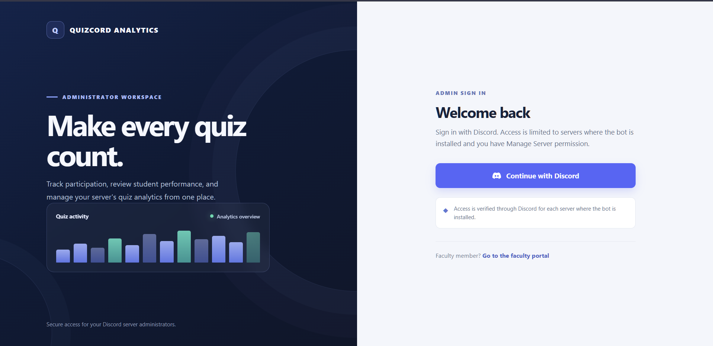
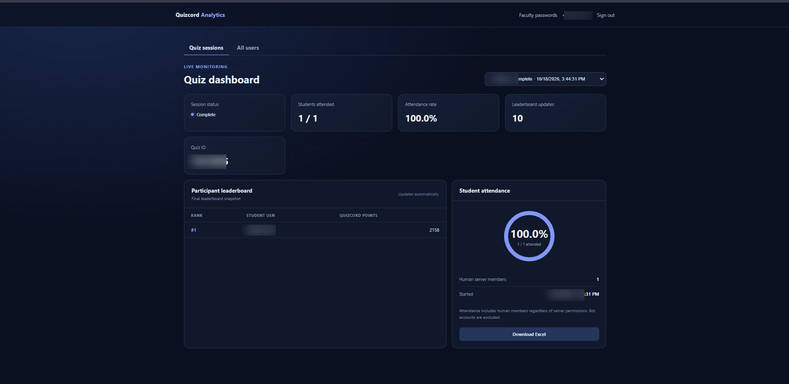
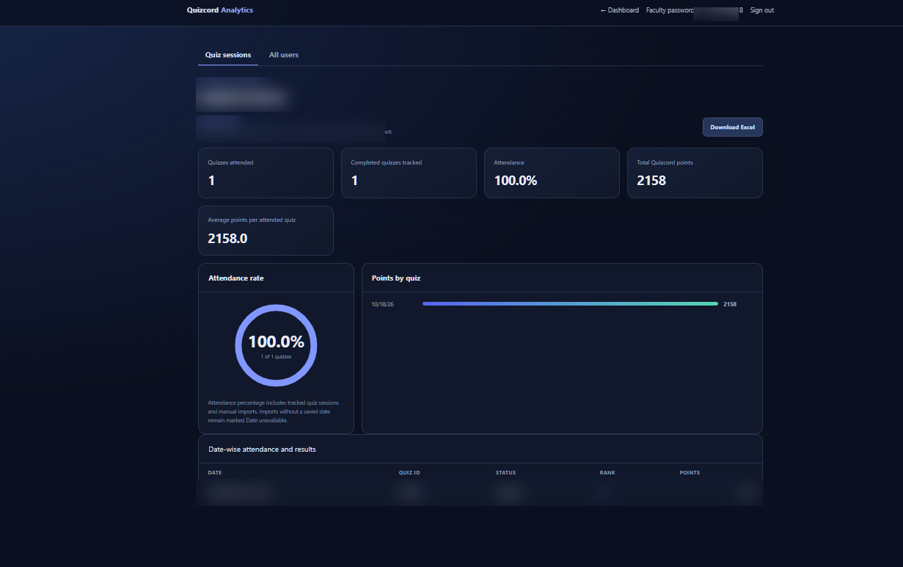

# Quizcord Analytics Bot


A production-structured Discord bot for linking server members to student
identifiers, importing Quizcord leaderboards, and privately viewing scores and
quiz attendance.

## Application screenshots







## Project structure

```text
.
├── .env.example
├── pyproject.toml
├── src/
│   └── quizcord_bot/
│       ├── cogs/analytics.py
│       ├── bot.py
│       ├── config.py
│       ├── database.py
│       ├── quizcord.py
│       └── views.py
└── tests/
```

The existing `fetch_users.py` remains as a small compatibility launcher.

## Quick setup for a Discord server

Server owners do not need Python, Railway, a bot token, or their own web
hosting. The bot publisher runs one shared bot service; you install that
published app in your server and configure only the server-specific options
you want.

1. Open the publisher's Discord install link, choose **Add to Server**, select
   your server, and authorize the requested permissions. You need **Manage
   Server** permission in that server.
2. Wait for the bot to join and for its slash commands to appear. Global
   commands can take a few minutes to become available after the publisher's
   first deployment.
3. Give the bot access to the channels where Quizcord posts quiz starts,
   leaderboards, and Quiz IDs. Automatic analytics then run without further
   setup.
4. Optional: to enable faculty dashboard access, create or choose a faculty
   role, assign it to faculty, and run `/set_faculty_role` in your server,
   selecting that role. This configuration applies only to your server. Skip
   this step if you do not need faculty dashboard access.
5. Use the slash commands when needed: `/map_student` to link a member to a
   student identifier, `/process_quizcord` to import a leaderboard manually,
   and `/export_analytics` to download analytics.

If the publisher has enabled the web dashboard, server administrators sign in
with Discord and **Manage Server** permission. Faculty can sign in after their
role is configured and an administrator provisions their faculty app password.
The publisher operates the dashboard; server owners do not configure OAuth,
Turnstile, Railway, or bot credentials.

This is a shared hosted app, not a separate bot copy that each server owner
runs. The publisher provides the install link and keeps the service running.
If you are publishing/hosting the bot rather than installing it, continue to
the operator setup below.

## Run or self-host the bot (publisher/operator)

- Python 3.10 or newer
- A Discord application/bot with the **Server Members Intent** enabled in the
  Discord Developer Portal
- The **Message Content Intent** enabled in both the Discord Developer Portal
  and the bot configuration; Discord gates message embed data behind this
  privileged intent.
- The bot invited with application-command and member permissions

The bot reads Quizcord leaderboard embeds, so it needs Message Content Intent
even though it does not parse ordinary message text.

In PowerShell, create the private environment file, edit in your real values,
and install the project:

```powershell
Copy-Item .\.env.example .\.env
notepad .\.env
python -m pip install -e .
python -m quizcord_bot
```

Alternatively, keep using the compatibility launcher:

```powershell
python .\fetch_users.py
```

`.env` is excluded from version control. Never commit a live Discord bot token.
If a token has previously been shared or committed, reset it in the Discord
Developer Portal.

### Environment variables

| Variable | Required | Purpose |
| --- | --- | --- |
| `DISCORD_BOT_TOKEN` | Yes | Discord bot token. |
| `QUIZCORD_BOT_ID` | No | Optional fixed Quizcord bot ID. Leave blank to detect bot/webhook quiz-start, leaderboard, and Quiz ID signals automatically. |
| `BOT_GUILD_ID` | No | Only needed when migrating old single-server data: set it to the server that owns the existing mappings/results. Leave blank for a fresh multi-server install. |
| `BOT_DATABASE_PATH` | No | SQLite database path. Defaults to `server_results.db` in the project directory. |
| `DASHBOARD_PUBLIC_URL` | No | Public HTTPS origin for the web dashboard, e.g. `https://analytics.example.com`. |
| `DISCORD_OAUTH_CLIENT_ID` | With dashboard | Discord application's OAuth2 client ID. |
| `DISCORD_OAUTH_CLIENT_SECRET` | With dashboard | Discord application's OAuth2 client secret. |
| `DASHBOARD_SESSION_SECRET` | With dashboard | Unique session-signing secret, at least 32 characters. |
| `FACULTY_ROLE_ID` | No | Optional legacy role ID migrated to the `BOT_GUILD_ID` server. Configure faculty roles per server with `/set_faculty_role`. |
| `DASHBOARD_HOST` | No | Bind address; defaults to `127.0.0.1` behind a local reverse proxy. |
| `DASHBOARD_PORT` | No | Web server port; defaults to `8765`. |

### Faculty dashboard

Create a dedicated `Faculty` role in each server and assign it only to faculty
members. A server administrator with **Manage Server** runs
`/set_faculty_role` and selects that server's role; running the command without
a role disables faculty access for that server. Faculty sign in with Discord;
the dashboard checks their current server role through OAuth and requires that
server's configured role. The application checks the member's current roles
through Discord's server API using the configured bot token; no additional
member OAuth scope is required. The bot must remain a member of the server.
Administrators retain access to the admin dashboard in servers where they have
**Manage Server** permission. Faculty use a separate branded
sign-in page at `/faculty/login`: they authenticate with Discord first, then
enter an app-managed faculty password. The application never requests or stores
a Discord account password. Administrators authenticate with Discord's
server-management permission only; there is no separate admin app password.
Register `https://<your-dashboard-domain>/auth/callback` as an exact OAuth2
redirect URI in the same Discord application configured by
`DISCORD_OAUTH_CLIENT_ID` and `DISCORD_OAUTH_CLIENT_SECRET`. If the callback
reports an authorization-code exchange failure, verify that URI, the dashboard
public URL, and the application credentials match; restart sign-in after
correcting configuration so Discord issues a fresh authorization code.

### Configure the Discord app for multi-server installation

The bot processes each server independently. Student mappings, quiz attendance,
leaderboards, faculty assignments, faculty passwords, and faculty-role settings
are scoped to the server that owns them. Dashboard users select an installed
server they administer or where they have the configured Faculty role; API
requests are checked against that server selection.

These are one-time publisher/operator tasks. Once completed, server owners only
need the install link and in-server steps above:

1. In the Discord Developer Portal, enable **Public Bot** and configure
   **Installation** for **Guild Install**. Use the `bot` and
   `applications.commands` scopes. For the bot permissions, grant only
   **View Channels**, **Send Messages**, **Read Message History**, **Embed
   Links**, and **Attach Files**. Do not grant Administrator or Manage Server.
2. Keep **Server Members Intent** and **Message Content Intent** enabled under
   **Bot → Privileged Gateway Intents**. Discord may require approval for these
   intents if the bot becomes large.
3. Share the Developer Portal's generated Guild Install link with server
   owners. For each installation, an administrator should confirm the
   requested permissions and grant them. The bot must be allowed to view the
   channels where Quizcord posts its quiz-start, leaderboard, and Quiz ID
   messages. Limit its channel access to the channels it needs.
4. Use `/set_faculty_role` separately in every server that wants faculty
   dashboard access. Admins can manage analytics without configuring a faculty
   role. Do not reuse one server's role ID in another; Discord role IDs are
   server-specific.
5. In the Discord Developer Portal, enable global application commands for the
   application. This bot synchronizes commands globally; new or changed
   commands can take time to appear in every server.

The same bot process and dashboard serve all installed servers. Keep the
deployment running, use a persistent database volume, and keep one application
replica while SQLite and dashboard login sessions are process-local. The bot
records an installation when it joins a server and marks it inactive when it
leaves. Leaving and reinstalling preserves that server's historical analytics
and configuration in the database.

For an existing single-server database, back it up first and set
`BOT_GUILD_ID` to the server that owns the existing mappings/results before
starting the new version. Startup migrates the old global student mappings and
imported quiz results into that server's isolated records. If old data exists
but `BOT_GUILD_ID` is not set, startup stops with an explicit migration error
rather than guessing. Once migration is complete, the variable can remain set
or be removed. Existing quiz sessions already contain their server IDs and
remain associated with those servers.

Each faculty account manages its own student list on `/faculty`. Faculty can
search the synchronized human-member directory by USN and add or remove
students. A student is available for assignment when their saved USN exists or
their global display name matches an accepted USN format. Faculty can see
attendance and performance only for students in their own list; assignments
are isolated by faculty account and server.

Administrators can open **Faculty passwords** from the admin dashboard or visit
`/admin/faculty-passwords` to issue or reset a faculty member's app password.
The member must have the configured Faculty role. The temporary password is
shown only once; share it securely. On first use, faculty must replace it with
a password of at least 12 characters. Passwords are stored as salted PBKDF2
hashes, and five consecutive failed attempts lock password verification for
15 minutes. HOD/faculty passwords may use any characters, must be 12–128
characters long, and do not require a specific character mix. To reset a
forgotten faculty password, an administrator can issue a new temporary
password. Email password recovery is disabled for now and can be added later
when a verified sender domain and delivery provider are available.

The faculty password page requires Cloudflare Turnstile before the password
field is enabled or any password is submitted. Create a Managed Turnstile
widget for the dashboard hostname and configure its site key as
`TURNSTILE_SITE_KEY` and its secret key as `TURNSTILE_SECRET_KEY` in the local
`.env` or the deployment environment (for Railway, add both as service
variables). The keys must be set together. Keep the secret key private and
never put it in browser code or share it in chat. The server validates every
challenge with Cloudflare and checks the configured hostname and
`faculty_password` action. If server-side verification is required but the keys
are missing or Cloudflare cannot be reached, password verification fails
closed until the configuration or service is restored.

The dashboard also applies per-client sliding-window limits: 300 requests per
minute overall (except health checks); 12 OAuth sign-in starts and 20 OAuth
callbacks per minute; 10 faculty password verifications and 10 password
changes per 15 minutes; 10 faculty password provisions per minute; 30
faculty-directory searches per minute; and 120 API requests per minute overall.
Limited requests return HTTP 429 with a `Retry-After` header. These counters
are held in the web process memory, are bounded, and reset when the process
restarts. They are not shared across multiple service replicas.

Application rate limits only reject requests after traffic reaches this
process; they do not absorb a network-level DDoS or protect the public network
bandwidth. Because the web dashboard and Discord bot run in the same process,
a sufficiently large flood can consume service resources and affect both.
The limiter uses Railway's `X-Real-IP` request header to distinguish clients;
only do this when traffic reaches the app through Railway's edge, which supplies
that header. For another host or a direct deployment, configure client IP
handling to trust headers only from known reverse proxies. Use Railway's
platform-level protections and, if needed, edge rules or a trusted WAF/CDN for
volumetric attacks. If deploying multiple app replicas, move rate-limit
counters to a shared store such as Redis.

### Enable the web dashboard

The dashboard is served by the same process as the Discord bot. Railway is a
supported single-service deployment:

1. For the initial deployment, install Railway's CLI and deploy this project
   directory from PowerShell:

   ```powershell
   npm install -g @railway/cli
   railway login
   Set-Location C:\Users\chand\Desktop\discord_bot
   railway up
   ```

   `railway up` deploys the current directory. `.env`, `.venv`, and local
   database files are excluded by `.gitignore`; do not use the CLI's
   `--no-gitignore` option.

   To deploy automatically instead of running `railway up` each time:

   - Push this project to GitHub on the `main` branch. The workflow at
     `.github/workflows/deploy-railway.yml` deploys each push to Railway and
     can also be started manually from the repository's **Actions** tab.
   - In Railway, create a **project token** for the project/environment that
     hosts this bot. In the GitHub repository, open **Settings → Secrets and
     variables → Actions → New repository secret**, name it exactly
     `RAILWAY_TOKEN`, and paste the project token as its value. Do not put the
     Railway token in source code, `.env`, or a GitHub Actions variable.
     The workflow checks that this secret is present before invoking Railway.
   - If your deployment branch is not `main`, update the workflow's branch
     filter to match it. The automated workflow requires the repository to be
     pushed to GitHub and this project to be linked/configured in Railway.

2. In Railway, open the created service and add a **Volume** mounted at
   `/data`. Set `BOT_DATABASE_PATH=/data/server_results.db`.
3. In the service's **Settings → Deploy**, set the start command to
   `python railway_start.py`. This launcher adds the project's `src` directory
   to Python's import path before starting the bot. The Railway requirements
   file lists runtime dependencies without installing the local package in
   Railpack's dependency-only build layer. Keep only one replica because
   SQLite and in-memory OAuth sessions are intended for a single running
   instance.
4. Under **Settings → Networking**, generate a Railway domain. Railway gives
   the service HTTPS and injects the port as `PORT`; this app reads that
   variable automatically. In the service variables, set:

   ```powershell
   DASHBOARD_PUBLIC_URL=https://your-service.up.railway.app
   DASHBOARD_HOST=0.0.0.0
   BOT_DATABASE_PATH=/data/server_results.db
   ```

   Replace the example domain with the exact Railway HTTPS domain. Do not set
   `DASHBOARD_PORT`; Railway supplies `PORT`.
5. In the Discord Developer Portal, open the same Discord application used by
   the bot. Set `DISCORD_OAUTH_CLIENT_ID` to its **Application ID**, create an
   OAuth2 client secret, and set it as `DISCORD_OAUTH_CLIENT_SECRET`. Add this
   exact redirect URL under OAuth2 redirects:

   ```text
   https://your-service.up.railway.app/auth/callback
   ```

   The public policy pages are available at
   `https://your-service.up.railway.app/privacy` and
   `https://your-service.up.railway.app/terms`. Review them for accuracy and
   add those URLs to the Discord application's Privacy Policy and Terms of
   Service fields before requesting verification or App Directory listing.

6. Generate a long random secret on your own computer:

   ```powershell
   python -c "import secrets; print(secrets.token_urlsafe(48))"
   ```

   Set the output as `DASHBOARD_SESSION_SECRET` in Railway. Also set
   `DISCORD_BOT_TOKEN`, `BOT_GUILD_ID`, and optionally `QUIZCORD_BOT_ID` in
   Railway's service variables. Never paste these secrets into source files,
   chat, or a public repository.
7. Apply the staged variable changes and deploy/restart the service. Check
   Railway's deployment logs, then open
   `https://your-service.up.railway.app/health`; it should return
   `{"status":"ok"}`. Sign in at the base URL with a Discord account that owns
   the server or has **Manage Server** / **Administrator** permission.

At quiz start, the server owner receives a private Discord DM with an **Open
live web dashboard** button. The dashboard refreshes every few seconds and
shows the roster, final analytics, and Excel download.

If you already have student mappings/results in a local `server_results.db`,
stop the local bot and back up the database before moving it. Upload that file
to the Railway volume at `/server_results.db` (the volume's root path; it
appears to the app as `/data/server_results.db`) before relying on the hosted
service's database. Otherwise, the hosted bot will initialize a new database
and you will need to recreate the mappings.

Railway's volume prevents database loss on redeploy, but OAuth sessions are
held in memory; they expire after an hour and are cleared on restart. Sign in
again after a deployment. Railway-hosted services and storage may incur charges;
check the current Railway plan and usage before leaving the service running.

For a local machine with a separately configured HTTPS reverse proxy, use
`DASHBOARD_HOST=127.0.0.1` and `DASHBOARD_PORT=8765` instead of Railway's host
and injected `PORT` settings. If the dashboard variables are omitted, the bot
continues to use its private Discord dashboard.

## Features

- `/map_student`: Link a server member to a student identifier and display
  name; optionally provide their Quizcord leaderboard nickname so it can be
  matched even when it differs from their Discord username/nickname.
- `/process_quizcord`: Import leaderboard text and privately open scorecards
  for every listed student. Rows without a unique student mapping are shown
  using their leaderboard nickname/USN. When the quiz start was tracked, its
  start date and time are saved automatically. Its optional `quiz_date` field
  accepts `YYYY-MM-DD` for a date override; if the start was not tracked and
  no override is provided, the import timestamp is saved.
- `/export_analytics`: Download the private aggregate Excel workbook (`.xlsx`).
- Detect the Quizcord question-one/start signal and privately notify the server
  owner with the web dashboard link when configured. If no start signal is
  visible, monitoring begins at the first leaderboard. The same leaderboard
  message is observed when edited; each distinct revision updates the roster
  and question-update count.
- The dashboard refreshes live leaderboard data and links each participant
  USN to an individual student page. Student pages show date-wise quiz
  attendance, completed-quiz attendance percentage with a circular progress
  chart, and Quizcord points by quiz. Each student page offers an Excel
  download with that student's summary and date-wise quiz history. The roster
  and student pages do not expose internal mapping status; final quiz data
  can also be exported to Excel. Administrators can open the **All users**
  dashboard tab to search the selected server's synchronized human members,
  see their global display name, account username, server nickname, and student
  mapping, and identify users whose global display name is missing or does not
  match an accepted USN format. If a member has no saved USN mapping but their
  global display name exactly matches an accepted USN format, the directory
  shows that value as their USN; this inferred value does not create a student
  mapping or populate a student name.
  The Discord fallback buttons remain usable after a bot restart.
- Quiz attendance summaries show attendees over the human guild-member count
  and an attendance percentage. The dashboard labels this count
  "Students attending" while live and "Students attended" after completion.
  The denominator includes all human members regardless of server permissions
  and excludes bot accounts; it is snapshotted when each live quiz starts.
  Leaderboard results from owners and administrators are counted like any
  other human member. Names are matched against saved USNs and Discord or
  Quizcord aliases. Discord mention results are resolved to cached member
  display names, including when the member has no student mapping. If a
  leaderboard name contains multiple Discord mentions, a unique registered
  account among those mentions is used to associate the result with its
  existing student record instead of creating a second student. On startup,
  existing composite-mention rows are also repaired when exactly one mentioned
  account has a registered student mapping.
- Student Discord global display names are checked against `4GM` + 2 digits + `CS` + 3
  digits or `U` + 2 digits + `E` + 2 digits + `CS` + 3 digits. A mismatch
  never blocks quiz results: the dashboard shows "Name not updated to USN".
  For a mapped student, the bot sends one private reminder per quiz
  asking them to set their Discord global display name to their saved USN;
  their unique account username does not need to change. The reminder is
  skipped when Discord DMs are unavailable.
- The first usable leaderboard revision and later edits are deduplicated by
  message/revision. Unknown USNs are retained in the quiz roster; known
  students are associated internally through Discord account username, server
  nickname, or their saved Quizcord username. `@nickname` values are normalized.
- Editing a final leaderboard to add its Quiz ID updates the original quiz
  session instead of creating a second attendance record. Student history also
  collapses legacy duplicate records with matching channel, timestamp, rank,
  and points when one copy lacks the Quiz ID.
- Duel-mode manual leaderboard imports include all parsed participants in the
  private scorecard list. A row with an ambiguous or missing mapping is shown
  under its leaderboard name; mapping status is not exposed.
- The final leaderboard completes the session when labeled as final. If
  Quizcord posts the Quiz ID in a separate follow-up embed, that ID also marks
  the session complete and is attached to the final result.
- Scorecards show the student's rank, score, and the number of **distinct
  Quizcord quizzes** in which they appear in imported results. Re-importing or
  updating the same quiz does not increase the attendance count.
- Student profile attendance totals include older manually imported quiz
  results. New imports use the stored quiz start timestamp when that quiz was
  tracked, or the import timestamp when the start was not observed; `quiz_date`
  can override this with a date. Imports made before date tracking was added
  continue to show "Date unavailable" because their original quiz dates were
  not stored; the app never assigns them the date of a different or current
  quiz.
- Scorecards and Excel exports include total and average leaderboard points.
  Quizcord's leaderboard score is points, not a verified correct-answer count.
- Leaderboard buttons support pagination for larger classes.

The live attendee count is the number of distinct USNs in the latest
leaderboard snapshot. For a final quiz export, the final snapshot is
authoritative. The live question indicator counts distinct leaderboard
revisions; if Quizcord does not expose a total question count, the bot shows the
current update number rather than inventing a percentage. Once the final
leaderboard or its Quiz ID follow-up arrives, the dashboard marks the quiz
complete.

Quizcord leaderboard data provides points and rank, not a verified count of
correct answers. The dashboard and workbook therefore report Quizcord points
and clearly avoid presenting those points as correct-answer counts.

## Protections

- Management commands require **Manage Server** and are rate-limited.
- Application commands and automatic imports are scoped to the server where
  they are used; each server's data is isolated from every other server.
- Scorecards, manual-import dashboards, and live quiz notifications are private
  to their recipient; automatic notifications go to the server owner.
- The optional web dashboard uses Discord OAuth, server-admin authorization,
  expiring server-side sessions, HTTPS-only cookies, and no-cache/security
  response headers. Access is denied when current server permissions cannot
  be verified.
- Automatic monitoring runs in every installed server and accepts messages
  from a bot or webhook matching `QUIZCORD_BOT_ID` when configured,
  or bot/webhook question-start, leaderboard, and Quiz ID signals when it is
  blank.
- Input sizes and parsed leaderboard row counts are bounded.
- SQLite writes use parameterized queries, transactions, foreign-key checks,
  and a busy timeout. The existing database schema is migrated in place.
- Unexpected command and delivery errors are logged without exposing
  implementation details to users.

## Tests

Run the focused test suite after installing the package:

```powershell
python -m unittest discover -s tests -v
```
